<!-- =========================================================
  MEHRAB JALILIAN · GITHUB PROFILE
  Visual system: Midnight · Violet · Cyan
========================================================= -->

  

  

  
  
  
  

  

---

## ✦ About Me

<table>
  <tr>
    <td width="25%" align="center" valign="middle">
      
       
      <strong>Mehrab Jalilian</strong>
       
      مهراب جلیلیان
    </td>
    <td width="75%" valign="middle">
      

        I am an AI engineer and computer engineering student interested in turning
        research ideas into practical, measurable software.
      

      

        My work spans <strong>machine learning, computer vision, natural language processing,
        privacy-preserving AI, and performance engineering</strong>. I enjoy working across
        the full path — from data exploration and model development to evaluation,
        deployment-oriented systems, and optimization.
      

      

        I maintain <strong>27+ public project repositories</strong> covering applied ML,
        deep learning, NLP, computer vision, data analysis, and systems work.
      

    </td>
  </tr>
</table>

## ◈ Areas of Focus

<table>
  <tr>
    <td width="50%" valign="top">
      <h3>🧠 Machine Learning & AI Systems</h3>
      Model development · Evaluation · Reproducible pipelines · Applied AI
    </td>
    <td width="50%" valign="top">
      <h3>👁️ Computer Vision</h3>
      Image classification · Object detection · Medical imaging · OCR
    </td>
  </tr>
  <tr>
    <td width="50%" valign="top">
      <h3>💬 NLP & Language AI</h3>
      Text processing · Sentiment analysis · Classification · LLM tooling
    </td>
    <td width="50%" valign="top">
      <h3>🔐 Privacy-Preserving AI</h3>
      Federated learning · Differential privacy · Distributed ML
    </td>
  </tr>
  <tr>
    <td width="50%" valign="top">
      <h3>⚙️ Performance Engineering</h3>
      Memory latency · Cache behavior · Benchmarking · Systems measurement
    </td>
    <td width="50%" valign="top">
      <h3>📊 Data Science & Analytics</h3>
      EDA · Feature analysis · Statistical reasoning · Visualization
    </td>
  </tr>
</table>

---

## ✧ Selected Projects

<table>
  <tr>
    <td width="50%" valign="top">
      <h3>🚘 Persian License Plate Recognition</h3>
      
Computer-vision pipeline for Persian license-plate detection and recognition, including YOLO-based experiments.

      
    </td>
    <td width="50%" valign="top">
      <h3>🌿 Greenhouse AI Controller</h3>
      
Intelligent greenhouse control combining time-series forecasting and fuzzy-logic reasoning.

      
    </td>
  </tr>
  <tr>
    <td width="50%" valign="top">
      <h3>💬 Snapfood Sentiment Analysis</h3>
      
Persian food-delivery review analysis with text preprocessing, machine learning, and an application workflow.

      
    </td>
    <td width="50%" valign="top">
      <h3>🏡 California Housing Prediction</h3>
      
Regression workflow with preprocessing, model comparison, hyperparameter tuning, evaluation, and Docker execution.

      
    </td>
  </tr>
  <tr>
    <td width="50%" valign="top">
      <h3>❤️ Heart Disease Diagnosis</h3>
      
Machine-learning classification experiments for heart-disease risk analysis, with notebooks and Docker support.

      
    </td>
    <td width="50%" valign="top">
      <h3>⚡ MemoryLatencyAnalyzer</h3>
      
Linux/C++ tooling for memory latency, cache hierarchy behavior, memory bandwidth, and access-pattern analysis.

      
    </td>
  </tr>
</table>

  

---

## ⬡ Technology Stack

<strong>Languages · Engineering · Tools</strong>

  

<strong>AI · Machine Learning · Data</strong>

  

<strong>Web · Creative Technology</strong>

  

  
  
  
  
  
  

---

## ◉ GitHub Analytics

  
  

  

  

  

---

## 🐍 Contribution Journey

  <picture>
    <source media="(prefers-color-scheme: dark)" srcset="https://raw.githubusercontent.com/mehrabja/mehrabja/output/github-snake-dark.svg" />
    <source media="(prefers-color-scheme: light)" srcset="https://raw.githubusercontent.com/mehrabja/mehrabja/output/github-snake.svg" />
    
  </picture>

---

## ⌁ Research Interests

  
  
  
  
  

## ↗ Connect

  <a href="https://mehrabjalilian.site/">Website</a>
  &nbsp; · &nbsp;
  <a href="https://www.linkedin.com/in/mehrab-jalilian">LinkedIn</a>
  &nbsp; · &nbsp;
  <a href="https://github.com/mehrabja">GitHub</a>

  

  Mehrab Jalilian · مهراب جلیلیان

