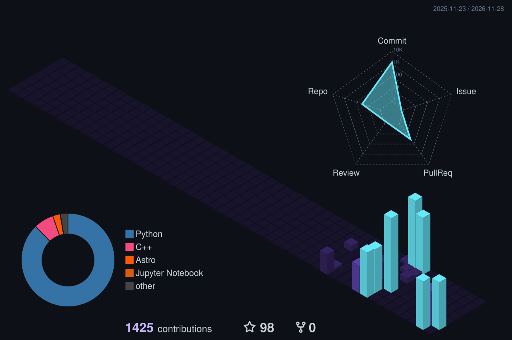

<!-- =========================================================
  MEHRAB JALILIAN · GITHUB PROFILE
  Visual system: Midnight · Violet · Cyan
========================================================= -->

  

  

  
  
  
  

  

---

## ✦ About Me

<table>
  <tr>
    <td width="190" align="center" valign="middle">
      
    </td>
    <td valign="middle">
      <h3>Mehrab Jalilian</h3>
      
<strong>AI ENGINEER · COMPUTER ENGINEERING STUDENT</strong>

      
I build intelligent software by connecting research, machine learning, and practical engineering. My work spans deep learning, computer vision, Persian NLP, LLM/RAG workflows, data systems, backend development, and systems-level experiments.

      
I work across the full lifecycle: data preparation, model development and evaluation, API and database design, containerization, automated testing, and deployment workflows.

    </td>
  </tr>
</table>

  

  34 PUBLIC REPOSITORIES · APPLIED AI · SOFTWARE & SYSTEMS ENGINEERING

## ◈ Engineering Domains

  

<table>
  <tr>
    <td width="50%" valign="top">
      <h3>🧠 AI, Machine Learning & Deep Learning</h3>
      Classical ML · Neural networks · CNNs · LSTMs · Forecasting · Model evaluation
    </td>
    <td width="50%" valign="top">
      <h3>🤖 LLM & Agent Engineering</h3>
      Transformers · Embeddings · RAG · Vector retrieval · Knowledge graphs · MCP
    </td>
  </tr>
  <tr>
    <td width="50%" valign="top">
      <h3>📊 Data Science & Analytics</h3>
      SQL · EDA · Data cleaning · Feature engineering · Statistics · Visualization
    </td>
    <td width="50%" valign="top">
      <h3>🧩 Backend & Data Systems</h3>
      REST APIs · FastAPI · Next.js · PostgreSQL · pgvector · Background workers
    </td>
  </tr>
  <tr>
    <td width="50%" valign="top">
      <h3>🚀 DevOps & MLOps</h3>
      Linux · Docker · CI/CD · GitHub Actions · Automated testing · Model lifecycle
    </td>
    <td width="50%" valign="top">
      <h3>🛡️ Security & Systems Engineering</h3>
      Application security foundations · Linux internals · x86-64 · Side-channel research · Defensive lab simulations
    </td>
  </tr>
  <tr>
    <td width="50%" valign="top">
      <h3>👁️ Computer Vision & NLP</h3>
      YOLO · OCR · Image classification · Persian NLP · Sentiment analysis · Transformers
    </td>
    <td width="50%" valign="top">
      <h3>🌐 Web & Creative Technology</h3>
      Astro · Three.js · GSAP · WebGL · Interactive experiences
    </td>
  </tr>
</table>

---

## ✧ Selected Projects

  

<table>
  <tr>
    <td width="50%" valign="top">
      <h3>🚘 Persian License Plate Recognition</h3>
      
Persian license-plate detection and recognition pipeline with YOLO-based computer-vision experiments.

      <a href="https://github.com/mehrabja/Persian-Car-Licence-Plate-Detection-and-Recognition">↗ Explore repository</a>
    </td>
    <td width="50%" valign="top">
      <h3>🌿 Greenhouse AI Controller</h3>
      
Intelligent greenhouse control combining time-series forecasting and fuzzy-logic reasoning.

      <a href="https://github.com/mehrabja/Greenhouse-Ai-Controler">↗ Explore repository</a>
    </td>
  </tr>
  <tr>
    <td width="50%" valign="top">
      <h3>💬 Snapfood Sentiment Analysis</h3>
      
Persian food-delivery review analysis using text preprocessing, machine learning, and an application workflow.

      <a href="https://github.com/mehrabja/snapfood-reviews-sentiment-classification-NLP">↗ Explore repository</a>
    </td>
    <td width="50%" valign="top">
      <h3>🏡 California Housing Prediction</h3>
      
End-to-end regression workflow with preprocessing, model comparison, tuning, evaluation, and Docker execution.

      <a href="https://github.com/mehrabja/California-Housing-Price-Prediction">↗ Explore repository</a>
    </td>
  </tr>
  <tr>
    <td width="50%" valign="top">
      <h3>❤️ Heart Disease Diagnosis</h3>
      
Machine-learning classification experiments with notebooks and Docker support.

      <a href="https://github.com/mehrabja/Heart-Disease-Diagnosis">↗ Explore repository</a>
    </td>
    <td width="50%" valign="top">
      <h3>⚡ MemoryLatencyAnalyzer</h3>
      
Linux/C++ microarchitecture lab for cache and memory performance, timing-side-channel experiments, and defensive-control evaluation.

      <a href="https://github.com/mehrabja/MemoryLatencyAnalyzer">↗ Explore repository</a>
    </td>
  </tr>
  <tr>
    <td width="50%" valign="top">
      <h3>🔬 Research AI</h3>
      
Full-stack research workspace with Next.js, FastAPI, PostgreSQL/pgvector, grounded RAG, document processing, and knowledge graphs.

      <a href="https://github.com/mehrabja/research-ai">↗ Explore repository</a>
    </td>
    <td width="50%" valign="top">
      <h3>⚡ spice-ts</h3>
      
TypeScript-native circuit simulator for Node.js and the browser, with a structured API and MCP server interface.

      <a href="https://github.com/mehrabja/spice-ts">↗ Explore repository</a>
    </td>
  </tr>
  <tr>
    <td width="50%" valign="top">
      <h3>🌌 Interactive Portfolio</h3>
      
Astro, Three.js, and GSAP web experience exploring WebGL visuals, motion design, and interactive presentation.

      <a href="https://github.com/mehrabja/website">↗ Explore repository</a>
    </td>
    <td width="50%" valign="top">
      <h3>📈 Data Analytics & EDA</h3>
      
Exploratory workflows for data cleaning, feature encoding, scaling, outlier analysis, segmentation, and visualization.

      <a href="https://github.com/mehrabja/EDA">↗ Explore repository</a>
    </td>
  </tr>
</table>

  

## ✦ Engineering Flagships

  

<table>
  <tr>
    <td width="33%" valign="top">
      <h3>🤖 ContextForge</h3>
      
Source-grounded RAG API with document ingestion, ranked retrieval, citations, optional LLM generation, and offline evaluation

      
      
      
    </td>
    <td width="33%" valign="top">
      <h3>🛡️ RepoSentinel</h3>
      
Local defensive repository scanner for secret patterns, unsafe code/configuration, severity gates, JSON, and SARIF reports

      
      
      
    </td>
    <td width="33%" valign="top">
      <h3>🚀 ModelOps Launchpad</h3>
      
Reproducible model training, FastAPI inference, health/readiness, Prometheus histogram metrics, Docker, and CI

      
      
      
    </td>
  </tr>
</table>

  Coverage snapshots measured in GitHub Actions on 2026-11-27 · Not coverage gates · See linked workflow runs for details

  THREE HANDS-ON PROJECTS · ONE ENGINEERING WORKSPACE

---

## ⬡ Languages, Skills & Technology Stack

  PROJECT-BACKED TECHNOLOGIES · TOOLS REFERENCED IN MY PUBLIC PROJECTS

### 💻 Programming, Scripting & Web Languages

  

  
  

### 🧠 Machine Learning & Deep Learning

  

  
  
  
  
  
  
  
  
  
  
  

  Classification · Regression · CNNs · LSTMs · Time-series forecasting · Feature engineering · Cross-validation · Hyperparameter tuning · Model evaluation · Image processing · OCR · Sentiment analysis

### 🤖 LLMs, RAG & Agentic Systems

  
  
  
  
  
  
  

  Document ingestion · Chunking · Embedding pipelines · Context retrieval · Grounded generation · Citation and evidence provenance · MCP server integration · Prompt and context design

### 📊 Data Science, Analytics & Data Processing

  
  
  
  
  
  
  

  Exploratory data analysis · Data cleaning · Missing-value and outlier handling · Feature encoding and scaling · Descriptive statistics · Correlation analysis · Time-series decomposition · ACF/PACF · Visualization · Experimental measurement

### 🧩 Backend Engineering, APIs & Databases

  

  
  
  
  
  
  
  

  REST API design · Typed request/response validation · Authentication and OAuth flows · Role-based access control · Database schema and migrations · Background workers · Durable jobs · File-storage adapters · Full-stack application architecture

### 🚀 DevOps, MLOps & Software Quality

  

  
  
  
  
  
  
  

  Containerization · Compose-based local environments · CI workflows · Automated tests · Type checking · Linting · Build systems · Reproducible experiments · Model deployment foundations

### 🛡️ Cybersecurity, Systems & Performance

  
  
  
  
  

  CPU microarchitecture · Cache hierarchy · Timing measurement · Memory ordering · Lock-free atomics · Shared memory · NUMA experiments · Side-channel measurement · Benchmark design · Defensive control evaluation

  Security lab scope: the Spectre demonstration is educational and local. EDR, DLP, egress, and detection scenarios in the project are synthetic control simulations, not integrations with production security products.

### 🎨 Web & Interactive Experiences

  

  
  
  

---

## ✦ Learning Roadmap

  TOOLS AND PRACTICES I AM EXPLORING OR PLAN TO DEEPEN — NOT A CLAIM OF EXPERT-LEVEL PROFICIENCY

  

<table>
  <tr>
    <td width="50%" valign="top">
      <h3>01 · Model Intelligence</h3>
      PyTorch · PEFT / LoRA · QLoRA · vLLM · SGLang · LangGraph · LlamaIndex · RAG evaluation
    </td>
    <td width="50%" valign="top">
      <h3>02 · Data & Distributed Systems</h3>
      Apache Spark · Airflow · dbt · DuckDB · Redis · Kafka · RabbitMQ · GraphQL · gRPC · Celery
    </td>
  </tr>
  <tr>
    <td width="50%" valign="top">
      <h3>03 · Production MLOps & Cloud</h3>
      MLflow · Weights & Biases · Kubeflow · Prometheus · Grafana · OpenTelemetry · Evidently · Kubernetes · Helm · Terraform · Ansible · AWS · Azure · GCP · Argo CD
    </td>
    <td width="50%" valign="top">
      <h3>04 · Secure Engineering</h3>
      OWASP ASVS · OWASP Top 10 · OWASP LLM Top 10 · NIST CSF 2.0 · Secure SDLC · Threat modeling · Burp Suite · OWASP ZAP · Nmap · Wireshark · Wazuh · Trivy · Semgrep · SCA · SAST · DAST
    </td>
  </tr>
</table>

  
  
  

## ◉ GitHub Analytics

  
  

  

  

  

---

## ✦ 3D Contribution Galaxy

  

  ANIMATED 3D CONTRIBUTIONS · VIOLET × CYAN · AUTOMATIC DAILY REFRESH

---

## 🐍 Contribution Journey

  <picture>
    <source media="(prefers-color-scheme: dark)" srcset="https://raw.githubusercontent.com/mehrabja/mehrabja/output/github-snake-dark.svg" />
    <source media="(prefers-color-scheme: light)" srcset="https://raw.githubusercontent.com/mehrabja/mehrabja/output/github-snake.svg" />
    
  </picture>

---

## ⌁ Research Interests

  
  
  
  
  

## ↗ Connect

  <a href="https://mehrabjalilian.site/">Website</a>
  &nbsp; · &nbsp;
  <a href="https://www.linkedin.com/in/mehrab-jalilian">LinkedIn</a>
  &nbsp; · &nbsp;
  <a href="https://github.com/mehrabja">GitHub</a>

  

  Mehrab Jalilian · مهراب جلیلیان

